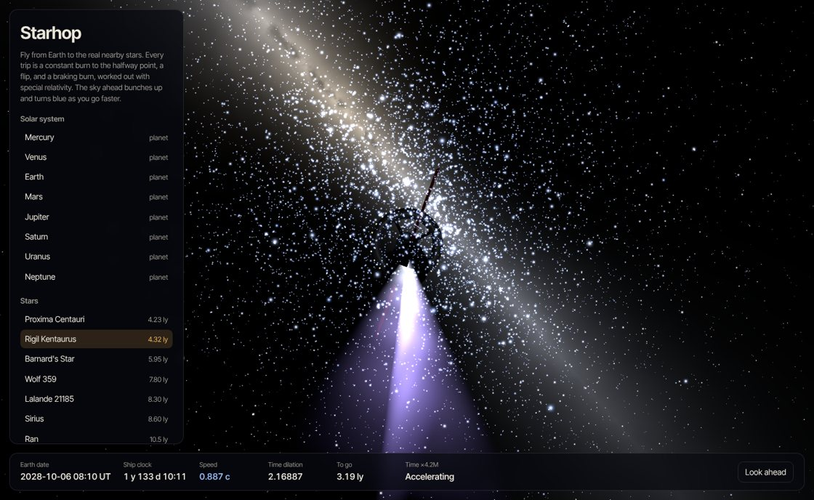
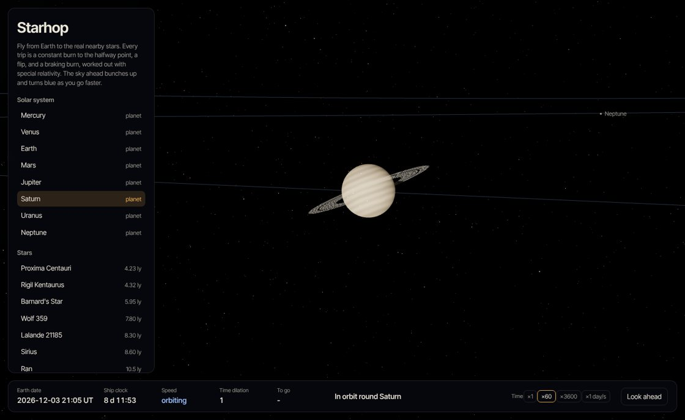

# Starhop

Fly a ship from Earth to the real nearby stars, in the browser, by physics alone. The sky is the HYG catalog's
17,753 brightest and nearest stars at their measured positions; the planets are where JPL's orbital elements
put them today. Every trip is a constant burn to the halfway point, a flip, and a braking burn, timed with
special relativity, and the sky you see on the way is what a ship at that speed would see: stars crowd
forward, turn blue ahead and red behind. No AI, no textures downloaded, nothing learned.



## Run it

```bash
python3 -m http.server 8792
```

Open <http://localhost:8792/web/>. You start in orbit round Earth, on today's date. Pick a planet or a star,
choose the thrust (0.1 to 5 g), and **Set off**. The trip plays in 20 seconds to 2 minutes whatever its length;
the read-outs show the Earth date, the ship's own clock, the speed, the time dilation and the distance to go.
Drag to look round the ship, scroll to zoom out (all the way to the whole system), and use **Time** to speed up
the orbit once you arrive.

It needs no graphics card. Without one, the browser draws in software, and the page draws fewer pixels when
frames come slowly; on a 2-core machine that way it runs at about 30 frames a second.

Tests and the accuracy check need Node 22, and nothing else:

```bash
npm test
node tools/eval.mjs
```

## How it works

1. **Stars** (`tools/pack_stars.py`, `src/stars.js`). From the HYG database: every star brighter than
   magnitude 7 seen from the Sun, plus every star within 25 parsecs, with position, absolute magnitude and B-V
   colour, turned into the J2000 ecliptic frame the planets use. Temperature comes from B-V (Ballesteros 2012);
   colour from Planck's law integrated against the CIE 1931 colour matching functions; brightness from the
   distance to the ship each frame, so stars brighten as you approach them.
2. **The solar system** (`src/solar.js`). JPL's Keplerian elements for approximate planet positions (valid 1800
   to 2050), each changing linearly with time, solved with Kepler's equation. Planets are tilted to their real
   poles (IAU values), so Saturn's rings sit 27 degrees off its orbit.
3. **Orbits** (`src/kepler.js`). Once you arrive you are put in a circular orbit and moved along it with the
   universal-variable propagator, which handles any conic exactly; a leapfrog integrator is kept to check it.
4. **The trip** (`src/relativity.js`). The relativistic rocket in closed form: at proper acceleration a, home
   time t = (c/a) sinh(a tau / c) and distance x = (c^2/a)(cosh(a tau / c) - 1) for ship time tau. A trip to a
   planet aims at where the planet will be when you arrive.
5. **The sky at speed** (`web/shaders.js`). Each star's direction is aberrated by the ship's velocity on the GPU,
   its temperature multiplied by the Doppler factor D, and its visual brightness raised by the exact blackbody
   factor (e^x - 1) / (e^(x/D) - 1). The Milky Way band, drawn from the galactic pole and centre directions, is
   aberrated the same way.
6. **Other star systems** (`src/systems.js`). The real catalog has no planets for most stars, so each star gets
   made-up ones, seeded by its catalog number so they never change. Spacing follows the star's luminosity, and
   each planet's type follows from its equilibrium temperature: lava worlds close in, gas giants and ice giants
   further out. The page says when a system is made up.
7. **Drawing** (`web/app.js`). The ship stays at the origin and everything else is placed relative to it in
   doubles, so nothing jitters a few light years from the Sun; a logarithmic depth buffer covers metres to
   parsecs. Planets are shaded procedurally (oceans and clouds, gas bands, ice, lava).

## How faithful it is

`tools/eval.mjs` checks the physics against answers known in advance:

| check | result |
|---|---|
| Kepler's equation vs the universal-variable propagator, 200 random orbits | agree to 3e-12 of the orbit's size |
| Leapfrog integrator, energy drift over one orbit | 4e-7 |
| Closed-form trip vs step-by-step integration of the rocket | agree to 3e-11 |
| Aberration: seen directions stay unit length; beta then -beta gives back the start | 3e-14; 6e-13 rad |
| 2856 K blackbody vs CIE Illuminant A (defined as that blackbody) | 0.0016 apart in xy |
| Catalog magnitudes rebuilt from the packed data | median 0.0003 mag off |
| Jupiter-Saturn great conjunction, December 2020 | closest gap 6.0 arcminutes, 17 h after 21 Dec 12:00 UT |
| Mars opposition, 13 October 2020 | found 11 hours from noon UT that day |
| Venus transit, 6 June 2012 01:30 UT | Venus 9.2 arcminutes from the Sun's centre, inside its 15.8 arcminute disc |

For scale: to Alpha Centauri at 1 g takes 3.6 years aboard and 6.0 years at home, at a top speed of 0.952 c.



## Not done yet

- **Real gravity during trips.** Trips are straight-line burns; the Sun's and planets' pull is ignored on the
  way. A proper n-body integrator, with gravity assists, would make planet trips honest.
- **The stars' own motion.** Star positions are fixed at the catalog epoch; proper motion and radial
  velocity are in HYG and could move them over the centuries a trip takes.
- **Moons**, asteroid belts, and planets' rings beyond Saturn's.
- **Light travel time.** Planets and stars are drawn where they are, not where their light left them.
- **Gravitational lensing** near stars, and a proper Milky Way from the catalog rather than a drawn band.
- **Docking and landing**: an orbit is as close as you get.

## Layout

- `src/` the physics, plain ES modules shared by the page and Node: `units.js`, `kepler.js`, `solar.js`,
  `relativity.js`, `stars.js`, `systems.js`
- `web/` the page: `index.html`, `app.js`, `shaders.js`, `style.css`, vendored three.js and font
- `data/` the packed star catalog and its licence
- `tools/` packing the catalog, the accuracy check
- `test/` `node --test`

Licence: MIT for the code ([LICENSE](LICENSE)). The star data in `data/` is CC BY-SA 4.0, from the HYG
database. Credits: [CREDITS.md](CREDITS.md).
